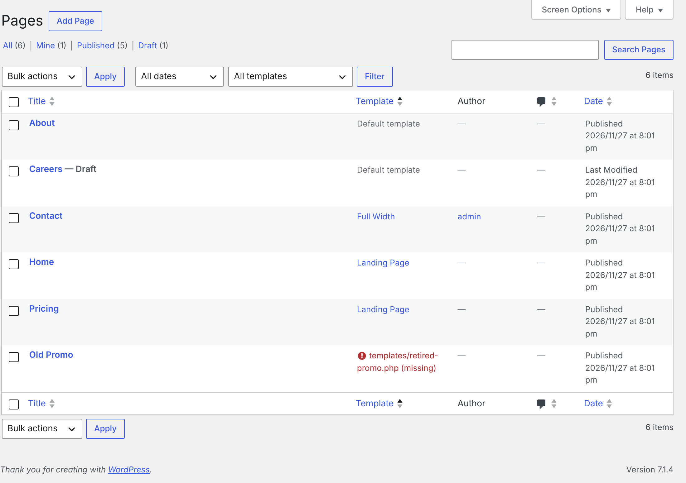

# Template Column

A WordPress plugin that shows which template every page, post and custom post type uses, right in the admin list. Sort by it, filter by it, and spot templates that no longer exist.



## Features

- **A Template column** on the admin list of every post type that can use templates, placed right after Title. It shows the template's name ("Landing Page"), not its file name.
- **Sort by template name.** The default template sorts first, then the named templates alphabetically, then missing ones. Ties sort by title.
- **Filter with the "All templates" dropdown.** It lists every template the theme offers for that post type, each with a post count, so you can also see templates nothing uses.
- **Click a template in the column** to list every post that uses it. The filter URL is shareable.
- **Missing templates are flagged.** When a post's template is gone (a theme switch, a deleted file), WordPress silently falls back to the default template. The column shows those in red with a warning, and the dropdown lets you list them all.
- **Classic and block themes.** Classic `Template Name:` headers (including `Template Post Type:`) and block theme custom templates both work, because the plugin asks core for the list rather than reading files.
- **Quick Edit friendly.** Changing a template in Quick Edit redraws the row with the new name.
- **No settings, nothing stored.** It reads the `_wp_page_template` value WordPress already keeps. Post types with no templates and no assigned templates get no column.

Requires WordPress 6.4+ and PHP 7.4+.

## How it works

Everything lives in [`includes/class-template-column.php`](includes/class-template-column.php).

- The plugin hooks `load-edit.php`, so it only does work on a post list screen, for the one post type being listed. Quick Edit's `inline-save` request gets the same hooks, since it redraws a single row outside that screen.
- Template names come from `wp_get_theme()->get_page_templates( null, $post_type )`, which merges classic and block theme templates.
- The counts in the dropdown come from one grouped query per screen load. "No meta", an empty value and `default` all count as the default template, which is how WordPress treats them.
- Filtering adds a `meta_query` clause in `pre_get_posts`. The default template needs an `OR` of `NOT EXISTS` and `IN ('', 'default')`.
- Sorting by name, not file, uses `posts_clauses`: a `LEFT JOIN` on the template meta and an `ORDER BY CASE` that maps each slug to its name. All values go through `$wpdb->prepare()`.
- Requested filters are checked against the templates this screen knows about, so an unknown value in the URL is ignored rather than showing an empty list.
- The query argument is `template_filter`, not `page_template`, because core's Quick Edit and Bulk Edit already post a field with that name in the same form.

To turn the column off for a post type:

```php
add_filter( 'template_column_enabled', function ( $enabled, $post_type ) {
	return 'post' === $post_type ? false : $enabled;
}, 10, 2 );
```

## Development

No build step. For a throwaway test site on PHP's built-in server and SQLite (no Docker, no MySQL):

```bash
npm install
npm run site:setup   # WordPress, this plugin, a small test theme and sample content
npm run site:start   # http://localhost:8890, admin / password
npm run test:e2e
npm run site:stop
```

The test theme in [`tests/fixtures`](tests/fixtures/template-column-test-theme) has three templates, a Books post type that has templates and a Notes post type that doesn't. [`bin/seed.php`](bin/seed.php) adds pages, posts and books with a spread of templates, including one page assigned to a template that no longer exists.

### Tests

The Playwright suite in [`tests/e2e`](tests/e2e/admin.spec.js) covers the column placement and names, the missing-template flag, the dropdown options and counts, filtering from the dropdown and from the column, ignoring unknown filters, sorting in both directions, sorting and filtering together, Quick Edit, custom post types with and without templates, and an axe accessibility check of the column and dropdown.

`composer install && composer lint` runs the WordPress Coding Standards. CI runs both on every push.

## Background

I wrote the first version in May 2024 while working on a client site with several custom post types, where editors needed to see at a glance which pages used which template. It started from Tom McFarlin's [Page Template Dashboard](https://github.com/tommcfarlin/page-template-dashboard), which adds a read-only column to Pages, and extended it to a fixed list of the site's custom post types.

This repository is a new implementation written from scratch in 2026. It detects post types on its own, adds sorting, filtering, counts and missing-template warnings, supports block themes and Quick Edit, and comes with tests.

## License

GPL-2.0-or-later. See [LICENSE](LICENSE).
